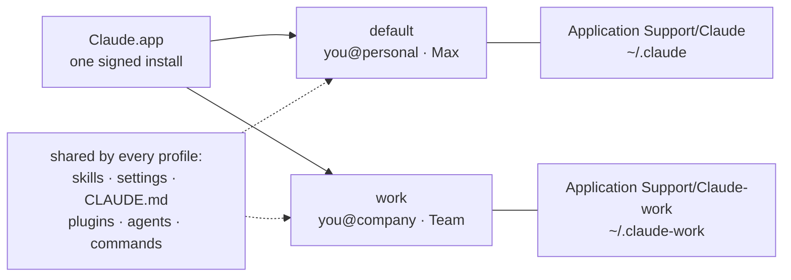
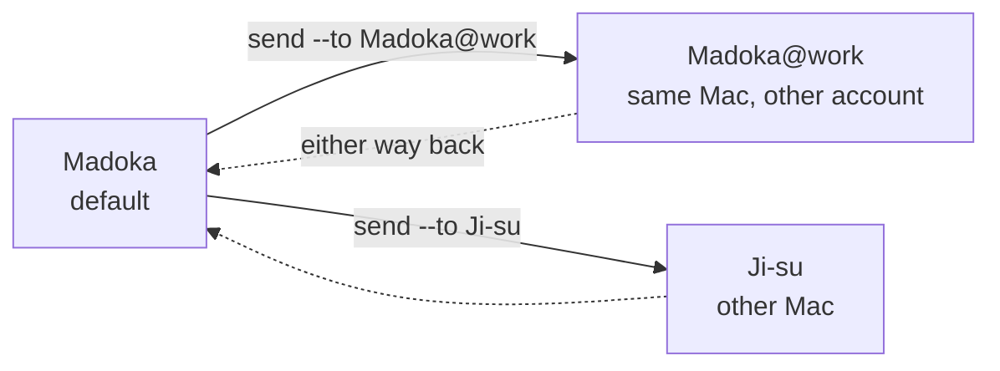

<div align="center">

# Claude Tandem

### Run every Claude account you have — side by side, on every Mac you have — and hand work between them without losing the thread.

<p>
  
  
  
  <a href="docs/findings.md"></a>
</p>

| You want to… | Claude alone | With Claude Tandem |
|---|---|---|
| Use a second Claude account while the first is open | ❌ one account signed in at a time | ✅ both apps, both Claude Codes, at once |
| Tell two open accounts apart | ❌ identical windows, identical Dock icons | ✅ names, badges, a badged Dock icon, a menu-bar switcher |
| Keep working when one account hits its limit | ❌ start over on the other account | ✅ hand the project across with its files, memory and a brief |
| Pick up on your other Mac | ⚠️ files sync; local projects, their chats and memory don't | ✅ one command per side, every byte verified |

</div>

---

## Contents

- [Quick start](#quick-start)
- [Several Claude accounts on one Mac](#several-claude-accounts-on-one-mac)
- [Telling them apart](#telling-them-apart)
- [Moving work between accounts and Macs](#moving-work-between-accounts-and-macs)
- [The menu-bar app](#the-menu-bar-app)
- [Install](#install)
- [Documentation](#documentation)

---

## Quick start

**A second account on this Mac** — no shared drive, nothing else to set up:

```bash
git clone git@github.com:altsang/claude-tandem.git ~/workspace/claude-tandem && cd ~/workspace/claude-tandem

./bin/tandem profile create work        # a profile: its own logins, sharing your skills and settings
./bin/tandem profile desktop work       # a second Claude app opens — sign in from a private browser window
./bin/tandem profile code work          # Claude Code as that account — sign in once
./bin/tandem menubar                    # see every account, and which window is which
```

**Your other Mac** — once per machine, then one command per side:

```bash
./bin/tandem deploy                                          # both Macs; uses iCloud Drive by default
./bin/tandem send "My Project" --to Ji-su --wait             # the Mac you're leaving
./bin/tandem receive "My Project"                            # the Mac you're arriving at, then ⌘V
```

Examples use the two Macs this was built and measured on — `Madoka` (desktop) and `Ji-su` (laptop) — and a second account named `work`.

---

## Several Claude accounts on one Mac

The Claude app and Claude Code each hold **one** signed-in account. If you have two subscriptions — personal and work, or a second plan for headroom — one sits idle while you use the other.

A **profile** is a second identity for both, kept in its own folders. Claude.app is never copied into or modified; every profile runs the real, signed app, side by side.



| | Per profile | Shared across profiles |
|---|---|---|
| Desktop sign-in, Cowork projects, project memory | ✅ own | |
| Claude Code sign-in and usage | ✅ own — separate Keychain logins, confirmed with two real accounts | |
| Skills, `settings.json`, `CLAUDE.md`, plugins, agents, commands | | ✅ one copy, so a change applies everywhere |
| Claude Code sessions | ✅ own — `tandem profile sync` copies them across so `--resume` works on either | |

```bash
./bin/tandem profile list
PROFILE          CODE (terminal)                    DESKTOP                            OPEN
default          you@personal.com (max)             account c9390ef8                   yes
work             you@company.com (team)             account d37cdc9d                   yes
```

Used an account in your regular Claude before giving it a profile? Its sessions aren't lost: the menu bar offers to bring them in when you sign in (`tandem profile adopt`).

Day to day you mostly won't type these: open accounts from their Dock launchers or the menu bar, and run `claude @work` in a terminal (a small zsh hook; `tandem profile code work` does the same anywhere).

**→ [The profiles guide](docs/profiles.md)** — creating and signing in, renaming, what happens when Claude updates, and how it works underneath.

---

## Telling them apart

Every profile runs the same Claude.app, so out of the box two open accounts look identical. Tandem gives each one a name and a face:

| | How |
|---|---|
| **A name** | `tandem profile rename work Junipera` — used everywhere you type or see it; its folders and logins never move |
| **A badge** | one or two letters in any script, an emoji, or an image: `--badge W` · `--badge 지` · `--badge 💼` · `--badge-image logo.png` |
| **A Dock launcher** | `tandem profile app work` — Claude's current icon, wearing the badge |
| **A badged Dock icon while it runs** | `--dock-icon` — the profile runs as its own copy of Claude.app (an APFS clone: no extra disk, still validly signed, no Keychain prompt — [finding 19](docs/findings.md)) |
| **The menu bar** | every profile with its badge, account, plan and whether it's open — [below](#the-menu-bar-app) |

---

## Moving work between accounts and Macs

The same two commands move a Cowork project **to another account on this Mac** or **to your other Mac**, because to Tandem each profile is simply another side: `Madoka`, `Madoka@work`, `Ji-su`.



What travels, and how:

| | Carried by |
|---|---|
| The project's files | the shared drive (iCloud by default) — Tandem forces real bytes and **md5-verifies every file** on arrival |
| The project itself — definition and folder link | `send` exports it, `receive` writes it into this Mac's or account's Claude |
| What Claude learned on the project | a memory snapshot — **merged** into whatever the receiver already knows, never overwritten |
| What you were in the middle of | `HANDOFF_*.md`, written in the session by the `/handoff` skill — the one thing no CLI can produce |
| Who holds the project now | an append-only ownership log, so two places never edit it at once |

```bash
# out of usage on this account? at the warning, not the wall: /handoff needs usage left
/handoff                                                       # in the Cowork session
./bin/tandem send "My Project" --to Madoka@work                # hand it to the other account
./bin/tandem --profile work receive "My Project"               # take it as that account, then ⌘V
```

<p align="center">
  
  <br/><sub>A handoff between Macs, both sides. Neither command returns until its half is provable — rendered from the tool's own output with measured timings; playback compressed.</sub>
</p>

**Do you need it?** Not for everything. A Cowork *remote* session's chat already appears on every Mac signed into that account; the everyday *host-loop* session in a local project — the kind that reads your files with no setup — never leaves its Mac, and that is the gap this fills ([finding 17](docs/findings.md)).

**→ [The handoffs guide](docs/handoffs.md)** — setting up the shared drive and the skill, the daily loop, locking a Mac out, memory, and timings.

---

## The menu-bar app

`./bin/tandem menubar` builds and opens **Claude Tandem**, a small native app with no Dock icon. Every item runs the same CLI, so it holds no logic of its own.

```
 ◎◎  Claude profiles on Madoka
     (A) default     you@personal.com · Max  · Open      ▸  Show Claude · Open Claude Code · Quit
     (J) Junipera    you@company.com · Team  · Open      ▸  Hand Off a Project ▸ project ▸ target
     ─────────────────────────────────────────              Receive a Project ▸ project
     New Profile…  ·  Sync Claude Code Sessions             Rename… · Change Badge… · Badge Colour
     Run Doctor  ·  Open at Login  ·  Quit                  Show Badge in the Dock  ✓
```

It flags a profile that needs reopening after Claude updates itself, offers to quit an account's app before receiving into it, and lists your other Mac as a handoff target as soon as the two have exchanged a project.

---

## Install

```bash
git clone git@github.com:altsang/claude-tandem.git ~/workspace/claude-tandem
```

| Needs | For |
|---|---|
| macOS with the Claude desktop app | everything — tested on macOS 26 and 27, Claude 4.29 |
| `bash`, `python3` | everything; `python3` with **Pillow** to draw badges |
| `swiftc` (`xcode-select --install`) | the menu-bar app only |
| A drive both Macs sync — iCloud Drive by default | handoffs between Macs only; profiles on one Mac need nothing shared |
| The `/handoff` skill — Claude › Settings › Skills › Add `skills/handoff/SKILL.md` | handoffs; skills sync by account, so add it once in each account you hand work *from* |

Optional: put `bin/` on your `PATH` to type `tandem` instead of `./bin/tandem`. `mirror` and `claude-profile`, the commands' names before this project became Claude Tandem, still work and say so.

---

## Documentation

| | |
|---|---|
| **[Profiles guide](docs/profiles.md)** | several accounts on one Mac — setup, naming and badges, updates, how it works |
| **[Handoffs guide](docs/handoffs.md)** | moving projects between accounts and Macs — shared drive, skill, daily loop, holds, memory |
| **[Command reference](docs/reference.md)** | every command and flag, the files Tandem keeps, environment variables |
| **[Troubleshooting](docs/troubleshooting.md)** | symptoms, causes and fixes — most of them silent failures found the hard way |
| **[Findings](docs/findings.md)** | the lab notebook: what was measured, when, and what turned out to be wrong |
