<div align="center">



# Claude Tandem

### Run every Claude account you have — side by side, on every Mac you have — and hand work between them without losing the thread.

<p>
  
  
  
  <a href="docs/findings.md"></a>
</p>

| You want to… | Claude alone | With Claude Tandem |
|---|---|---|
| Use a second Claude account while the first is open | ❌ one account signed in at a time | ✅ both apps, both Claude Codes, at once |
| Tell two open accounts apart | ❌ identical windows, identical Dock icons | ✅ names, badges, a badged Dock icon, a menu-bar switcher and a window |
| Keep working when one account hits its limit | ❌ start over on the other account | ✅ hand the project across with its files, memory and a brief |
| Pick up on your other Mac | ❌ files sync, but the session stays on the Mac it ran on: its chat, its project and its memory | ✅ one click per side, or one command — every byte verified |
| Know what's where | ❌ nothing says which Mac or account has a project | ✅ every project, every Mac and account, in one view — `tandem where` |

</div>

---

## Contents

- [Quick start](#quick-start)
- [Several Claude accounts on one Mac](#several-claude-accounts-on-one-mac)
- [Telling them apart](#telling-them-apart)
- [Moving work between accounts and Macs](#moving-work-between-accounts-and-macs) — [why handoffs exist](#why-handoffs-exist)
- [The app](#the-app)
- [Install](#install)
- [Documentation](#documentation)

---

## Quick start

**A second account on this Mac** — no shared drive, nothing else to set up:

```bash
brew install altsang/tap/claude-tandem

tandem profile create work        # a profile: its own logins, sharing your skills and settings
tandem profile desktop work       # a second Claude app opens — sign in from a private browser window
tandem profile code work          # Claude Code as that account — sign in once
tandem menubar                    # the app: every account, your handoffs, your Macs
```

**Your other Mac** — once per machine:

```bash
tandem deploy                                          # both Macs; uses iCloud Drive by default
tandem menubar                                         # both Macs; then Settings › Open at Login
```

From then on `/handoff` in a Claude session is the only thing you type: Tandem on this Mac asks to send it, and Tandem on the other one tells you it arrived. In a terminal or a script it's one command per side:

```bash
tandem send "My Project" --to Ji-su --wait             # the Mac you're leaving
tandem receive "My Project"                            # the Mac you're arriving at, then ⌘V
```

Examples use the two Macs this was built and measured on — `Madoka` (desktop) and `Ji-su` (laptop) — and a second account named `work`.

---

## Several Claude accounts on one Mac

The Claude app and Claude Code each hold **one** signed-in account. If you have two subscriptions — personal and work, or a second plan for headroom — one sits idle while you use the other.

A **profile** is a second identity for both, kept in its own folders. Claude.app is never copied into or modified; every profile runs the real, signed app, side by side.

<p align="center">
  
  <br/><sub>Two accounts, two windows, side by side — the second one wearing its badge in the Dock.</sub>
</p>

| | Per profile | Shared across profiles |
|---|---|---|
| Desktop sign-in, Claude projects, project memory | ✅ own | |
| Claude Code sign-in and usage | ✅ own — separate Keychain logins, confirmed with two real accounts | |
| Skills, `settings.json`, `CLAUDE.md`, plugins, agents, commands | | ✅ one copy, so a change applies everywhere |
| Claude Code sessions | ✅ own — `tandem profile sync` copies them across so `--resume` works on either | |

```bash
tandem profile list
PROFILE          CODE (terminal)                    DESKTOP                            OPEN
default          you@personal.com (max)             account c9390ef8                   yes
work             you@company.com (team)             account d37cdc9d                   yes
```

Used an account in your regular Claude before giving it a profile? Its sessions aren't lost: the app offers to bring them in when you sign in, and the menu bar keeps a **Bring In Earlier Sessions** item until you decide (`tandem profile adopt`).

Day to day you mostly won't type these: open accounts from their Dock launchers or the menu bar, and run `claude @work` in a terminal (a small zsh hook; `tandem profile code work` does the same anywhere).

**→ [The profiles guide](docs/profiles.md)** — creating and signing in, renaming, what happens when Claude updates, and how it works underneath.

---

## Telling them apart

Every profile runs the same Claude.app, so out of the box two open accounts look identical. Tandem gives each one a name and a face:

| | How |
|---|---|
| **A name** | on the profile's page in the app, or `tandem profile rename work Junipera` — used everywhere you type or see it; its folders and logins never move |
| **A badge** | one or two letters in any script, an emoji, or an image: `--badge W` · `--badge 지` · `--badge 💼` · `--badge-image logo.png` |
| **A Dock launcher** | `tandem profile app work` — Claude's current icon, wearing the badge. Pin this one from `~/Applications`, not the running app: a pinned running icon opens your default account ([why](docs/troubleshooting.md#profiles)) |
| **A badged Dock icon while it runs** | `--dock-icon` — the profile runs as its own copy of Claude.app (an APFS clone: no extra disk, still validly signed, no Keychain prompt — [finding 19](docs/findings.md)) |
| **The menu bar and the window** | every profile with its badge, account, plan and whether it's open — [below](#the-app) |

---

## Moving work between accounts and Macs

### Why handoffs exist

**A Claude session belongs to the Mac it started on.** The everyday kind, a *host-loop* session in a local project, which reads your folder with no setup, runs on this computer. Its chat, the project's definition and folder link, and what Claude learned while working all live on this Mac, under this account. iCloud can sync the project's files, but nothing that makes them a project Claude knows.

So the moment you move, the thread breaks:

- **To your laptop.** Claude on the other Mac has never heard of the project. The chat isn't there, nor the memory, and the files may have arrived as empty placeholders.
- **To your other account**, because this one is near its usage limit. Accounts share nothing, so the second one starts cold too.
- **Back and forth.** When both Macs can edit the same folder, nothing says which copy is current.

Claude Tandem was built to overcome that: to move a Claude project between Macs and accounts without losing the thread. A handoff carries everything that doesn't travel by itself:

- the project's definition, written into the receiving Claude;
- its memory, merged rather than overwritten;
- a brief of where you were, written by the session itself, since its chat can't move;
- every file, verified byte for byte;
- a record of who holds it now, so only one place works on it at a time.

*Remote* Claude sessions do sync their chat, but only between Macs signed into the same account, and they reach your files only through folders granted to each session. Handoffs are for everything else ([finding 17](docs/findings.md#17-there-are-two-session-stores--and-only-one-of-them-syncs)).

### How

The same two commands move a Claude project **to another account on this Mac** or **to your other Mac**, because to Tandem each profile is simply another side: `Madoka`, `Madoka@work`, `Ji-su`.

<p align="center">
  
  <br/><sub>Handing a project to your other account, before the first one runs out — terminal output from the tool itself, shortened.</sub>
</p>

What travels, and how:

| | Carried by |
|---|---|
| The project's files | the shared drive (iCloud by default) — Tandem forces real bytes and **md5-verifies every file** on arrival |
| The project itself — definition and folder link | `send` exports it, `receive` writes it into this Mac's or account's Claude |
| What Claude learned on the project | a memory snapshot — **merged** into whatever the receiver already knows, never overwritten |
| What you were in the middle of | `HANDOFF_*.md`, written in the session by the `/handoff` skill — the one thing no CLI can produce |
| Who holds the project now | an append-only ownership log, so two places never edit it at once |

```bash
# out of usage on this account? at the warning, not the wall: /handoff needs usage left
/handoff                                                       # in the Claude session
tandem send "My Project" --to Madoka@work                # hand it to the other account
tandem --profile work receive "My Project"               # take it as that account, then ⌘V
```

**With the app on both ends, there's no terminal at all.** `/handoff` writes the brief and says where it's going. Tandem on this Mac asks **Send it?**, and Tandem on the other side announces **It arrived — Receive**. Receiving verifies every file and claims the project at once, even with Claude open. The steps that need that Claude closed finish by themselves when it quits. **Open in Claude** brings up the right profile with the brief on the clipboard. You can also **ask** for a project from the Mac that doesn't have it.

<p align="center">
  
  <br/><sub>The same handoff through the app — a notification on each Mac, each step as the CLI reports it.</sub>
</p>

The same thing in a terminal, for scripts or a Mac without the app:

<p align="center">
  
  <br/><sub>A handoff between Macs, both sides. Neither command returns until its half is provable — rendered from the tool's own output with measured timings; playback compressed.</sub>
</p>

**→ [The handoffs guide](docs/handoffs.md)** — setting up the shared drive and the skill, the daily loop, locking a Mac out, memory, and timings.

---

## The app

`tandem menubar` builds and opens **Claude Tandem**, a native app: a menu-bar icon (the logo in miniature, two Clawds on a tandem) and a window. Every action runs the same CLI, so it holds no logic of its own.

<p align="center">
  
  <br/><sub>The menu bar: what's waiting, then every profile.</sub>
</p>

**The menu bar** is for the profiles you have, and for whatever is waiting:

- When something is waiting, the icon gets a dot, and the top of the menu lists it: a project arriving for one of your profiles, a brief ready to send, or your other Mac asking for a project.
- Each profile: Show or Open Claude, Open Claude Code, Quit, Receive, Hand Off, Bring In Earlier Sessions, and Show in Claude Tandem.
- **Open Claude Tandem…** opens the window, and **Settings…** (⌘,) its settings. Everything else is there.

<p align="center">
  
  <br/><sub>The window: what's waiting, who holds what, and every Mac.</sub>
</p>

**The window** (Open Claude Tandem…, or open the app from Finder) has the rest. Its title bar names the page and sums it up (*14 projects · 4 shared · 10 on one Mac*), and it has a menu bar like any Mac app's: ⌘1–⌘4 for the pages, ⌘R to check the shared drive now, ⌘N for a new profile, ⇧⌘H to hand off a project, and a Handoffs menu with what you can receive or ask for.

| | |
|---|---|
| **Get Started** | a checklist from a second profile to the `/handoff` skill. Once every step is done the window opens on the Inbox when something is waiting, else on Projects, and the checklist is under Help |
| **Inbox** | what's waiting for you, and sends and receives running now, step by step |
| **Projects** | a grid of every project against every place it can be: each profile on each Mac. A dot shows who has it, a ring an old copy, a square a project on one Mac only. Drag a project's mark to another place to move it there: it's handed off, asked for, or shared first when it's only on one Mac. Select one for where it is and its history. Right-click for Move To (the same moves without dragging), Open in Claude, History, the newest brief and Unlock |
| **Macs** | every Mac running Tandem: when it was last seen, its Tandem version and iCloud health, each profile on it with its account, and what each holds |
| **A profile** | the projects it holds (Hand Off…) and the ones coming to it (Receive), its accounts, its name, badge and Dock launcher. Show Claude, Claude Code and Quit are in the toolbar; right-click it in the sidebar for those and Rename. The **+** beside *Profiles*, or File › New Profile…, makes a new one |

**Settings** (⌘,) is a window of its own, with three tabs: **General** (Open at Login and your terminal), **Handoffs** (what happens when a handoff arrives or `/handoff` writes a brief) and **Maintenance** (Run Doctor, Sync Claude Code Sessions, conflict copies and the shared engine, with their output in place).

Leave **Open at Login** on, on every Mac. Tandem only notices handoffs, and publishes the card that puts this Mac on the other one's Macs page, while it runs.

**Everything in the app is a command too.** The app is a client of the CLI. `tandem inbox`, `tandem where --json` and `tandem config` show and set what it does. `tandem watch` is its background half without the app, for a server, a script or a LaunchAgent, with JSON events and hooks. See [Automation](docs/reference.md#automation).

---

## Install

```bash
brew install altsang/tap/claude-tandem
```

That puts `tandem` on your `PATH` and brings Python with **Pillow** for drawing badges. To update, on each Mac:

```bash
brew upgrade claude-tandem && tandem menubar           # the app is rebuilt from the new version
```

| Needs | For |
|---|---|
| macOS with the Claude desktop app | everything — tested on macOS 26 and 27, Claude 4.29 |
| [Homebrew](https://brew.sh) | the install above |
| Command Line Tools (`xcode-select --install`) | the app only — `tandem menubar` builds it on your Mac with `swiftc`; Xcode isn't needed (from 1.1.1) |
| A drive both Macs sync — iCloud Drive by default | handoffs between Macs only; profiles on one Mac need nothing shared |
| The `/handoff` skill — `tandem skill` shows the file; add it in Claude › Settings › Skills | handoffs; skills sync by account, so add it once in each account you hand work *from* |

**From a clone instead**, to follow `main` or change the code:

```bash
git clone git@github.com:altsang/claude-tandem.git ~/workspace/claude-tandem
```

then run `./bin/tandem`, or put `bin/` on your `PATH`. You'll need `python3` with Pillow yourself. `mirror` and `claude-profile`, the commands' names before this project became Claude Tandem, still work and say so.

---

## Documentation

| | |
|---|---|
| **[Profiles guide](docs/profiles.md)** | several accounts on one Mac — setup, naming and badges, updates, how it works |
| **[Handoffs guide](docs/handoffs.md)** | moving projects between accounts and Macs — shared drive, skill, daily loop, holds, memory |
| **[Command reference](docs/reference.md)** | every command and flag, the files Tandem keeps, environment variables, and [automation](docs/reference.md#automation): JSON, events, hooks, the app↔CLI table |
| **[Handoffs, rethought](docs/design-handoffs-v2.md)** | why handoffs work the way they do since 1.1: intents, notifications, deferred receive, presence |
| **[Troubleshooting](docs/troubleshooting.md)** | symptoms, causes and fixes — most of them silent failures found the hard way |
| **[Findings](docs/findings.md)** | the lab notebook: what was measured, when, and what turned out to be wrong |

---

<sub>**Claude Tandem is an independent, open-source project. It is not made, endorsed or supported by Anthropic.** Claude, Claude Code and the Clawd character are Anthropic's; Clawd appears in the logo as a tribute to the tool this one is built around, and the mockups draw Claude's app icon, simplified, to show where it appears in the Dock. Licensed under the [GNU General Public License v3.0 or later](LICENSE) from 1.3.0 on; versions up to 1.2.2 were released under MIT.</sub>
