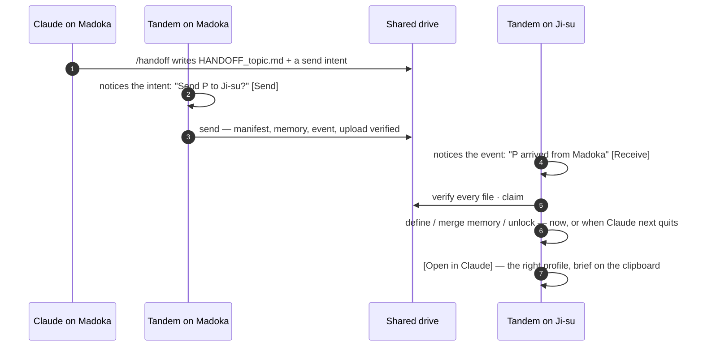

# Handoffs, rethought

Status: **built** in 1.1.0 (2026-11-01); since 1.1.1 the app also builds without Xcode. How to use it is in the [handoffs guide](handoffs.md#with-the-app). This page is the reasoning.

## What hurts today

A handoff works and it proves itself, but the person carries every step:

| Step | Today | Cost |
|---|---|---|
| 1 | `/handoff` in Claude writes the brief | fine — only the session can write it |
| 2 | Open a terminal, type `tandem send "P" --to Ji-su --note … --wait` | you remember the project's exact name and the other side's name |
| 3 | Walk to the other Mac, open a terminal, `tandem receive "P"` | nothing tells that Mac that anything is coming |
| 4 | If Claude is open there, `receive` stops before it claims: quit Claude, run it again | the one step that has to touch `spaces.json` blocks all the others |
| 5 | ⌘V the brief into Claude | fine |

And nothing answers **"where is everything right now?"**:

- `tandem status` shows who holds the *shared* projects.
- It can't say whether the other Mac is awake.
- It can't say which account on it has which project.
- It can't say what's still only on one Mac.
- It can't say what's half-way across.

## The shape of the new handoff



There's no terminal anywhere on the happy path. Each step is one click, or none.

### 1. The brief says where it's going

The `/handoff` skill still writes the document. It also writes a **send intent** next to it:

```
Projects/P/.handoff/intents/<topic>.json   {"to":"Ji-su","note":"…","doc":"HANDOFF_topic.md"}
```

- The session can write this: it's inside the project folder it was granted.
- It is a *request to the app*, not an ownership event. The mechanics still have one implementation: `tandem send`.

Tandem, on the Mac that holds the project, notices the intent within a minute and asks **"Send P to Ji-su?"**. If you set it to, it just sends.

An intent counts only while it is newer than the project's newest ownership event, so sending consumes it. Nothing needs deleting.

### 2. The other Mac is told

Tandem polls the shared drive in the background, enumerating the folders, which is what makes iCloud deliver to an idle Mac. It looks for handoff events addressed to any profile on this Mac. When one lands you get a notification:

> **Adobe Stock Plan arrived from Madoka** — for Personal · "THW done, 7 left" · [Receive]

Per Mac, choose one of three behaviours:

- **Ask** (the default): a notification with Receive.
- **Receive automatically**: receive, then a notification saying it's done.
- **Off**: the inbox in the window only.

Arrival is still drive speed, about 2–3 minutes. The notification is the drive's latency made visible, not hidden.

### 3. Receive never stops for a quit

Today `receive` stops *before claiming* if the project is new here and Claude is open, because defining a project writes `spaces.json`, which a running Claude overwrites. Split it:

| Part | Needs Claude quit? | When |
|---|---|---|
| wait for the event, md5-verify every file, claim | no | now |
| define the project + folder link (new here) | yes | now if quit, else **when that profile's Claude next quits** |
| merge the memory snapshot | yes | same |
| undo a `--hold` lock | yes | same |

The deferred part is recorded locally as **settling**. Tandem finishes it the moment that profile's Claude quits. It also offers **Quit Claude and Finish** if you want it now. The CLI gets this as `tandem receive --defer` and `tandem settle`.

### 4. Ask for it (pull)

From the Mac that *doesn't* hold a project, **Ask for it** writes a request:

```
Projects/P/.handoff/requests/<ts>-<side>.json
```

The holding Mac gets a notification: **"Ji-su asks for P"**. It offers:

- **Copy /handoff prompt**: you run it in that project's Claude session.
- **Send without a brief**, when there's nothing to say.

A request, too, is consumed by the next ownership event.

## What is where — the ledger

Every Tandem publishes a **presence card** for its Mac about every five minutes:

```
_handoff/presence/<Mac>/<ts>.json
  mac, at, Tandem version, iCloud state
  sides: [{ side "Madoka@work", name, account email, plan, Claude open?,
            projects defined there (names) }]
```

- It is one writer per folder and append-only, with the previous card deleted by its own writer. That avoids iCloud's in-place-edit problem.
- Cards are small and cheap to read.
- Merged with every project's event log, they give the **ledger**: `tandem where` and the window's **Handoffs** view.

| Section | Shows |
|---|---|
| **Waiting for you** | handoffs addressed to a profile here · briefs ready to send · requests from the other Mac · receives still settling |
| **In progress** | sends and receives running now, step by step; sent and not yet claimed |
| **Projects** | one list. Shared projects first: holder (Mac, profile, account), state, last move, note, brief. Then each project defined on one Mac only, marked *Only on <Mac>*: the ones a handoff can't reach yet. A collapsed group for these made projects look missing (2026-11-08). Projects that exist only on claude.ai aren't listed, since they're on every Mac already |
| **Macs** | each Mac: last seen, Tandem version, iCloud health; each profile on it, its account, whether Claude is open |

"Last seen 3 minutes ago" answers the question you used to answer by walking over. Is Ji-su awake, and will this arrive?

### Managing the Macs

The **Macs** page puts each Mac side by side, so keeping two (or more) in step is visible:

- **Online or asleep**: whether its card is recent.
- **Tandem version**: older than this Mac's is flagged, with the upgrade command.
- **iCloud Drive**: a stalled drive is the usual reason "nothing arrived" ([finding 18](findings.md)), so the card carries it, and this Mac's gets an **Open iCloud Drive** button.
- **Each profile**: its account, whether Claude is open, what it holds, and what's on its way to it.
- **No card**: a Mac known only from the ownership log, with how to bring it up to date.

## Compatibility

- `.handoff/events/` keeps exactly two verbs, `handoff` and `claim`. Every shipped engine treats the newest event as the truth about ownership, so a new verb there would read as a change of owner. Intents, requests and presence live in **sibling folders** that older versions never look at.
- A Mac on an older Tandem still sends and receives as before. It just doesn't publish presence or get notified.
- Everything stays append-only, one writer per file. Upload proof and md5 verification are unchanged. The app calls the same `tandem send` / `tandem receive`, with `TANDEM_STEPS=1` so they print machine-readable step markers.

## The menu bar and the window

The **menu bar** is for the profiles you already have, and for the inbox:

- **Waiting for you**: arrivals, briefs ready to send and requests, one click each. Shown only when there is something.
- **Each profile**: Show / Open Claude · Open Claude Code in Terminal · Quit Claude (Quit and Reopen after a Claude update) · Receive P (only what is addressed to it) · Hand Off ▸ (only projects this profile holds) · Bring In Earlier Sessions (when there are any) · Show in Claude Tandem…, which opens its page in the window.
- **Open Claude Tandem…** · **Settings…** (⌘,) · **Quit Claude Tandem**.

New profiles, Handoffs, Macs, renaming, badges and maintenance are all in the window. The menu is only for acting on what exists.

The **window** takes everything else, as a standard Mac sidebar window: the title bar names the page, and a main menu (File, Edit, View, Handoffs, Window, Help) carries every action with its shortcut. Its sidebar:

- **Get Started**: the setup checklist, until it's done; afterwards the window opens on Handoffs and the checklist is under Help.
- **Handoffs**: the ledger above. Check Now is ↻ in the toolbar and ⌘R.
- **Macs**: one card per Mac.
- **Profiles**: one page each, with Projects (what it holds, what's coming, what's locked), accounts, earlier sessions, name, badge and Dock; its Claude actions in the toolbar and on right-click. The **+** beside the section header, or ⌘N, makes a new one.

**Settings** (⌘,) is its own window, one tab each:
- **General**: Open at Login, and which terminal opens Claude Code.
- **Handoffs**: what happens when a handoff arrives, and when a brief is ready.
- **Maintenance**: Run Doctor (`tandem doctor`: the drive, iCloud, the engine, folder links and Claude.app's compatibility with profiles), Sync Claude Code sessions, Find conflict copies, Update the shared engine. Each runs its CLI command and shows the output in place, not in a terminal.

## One implementation, two front ends

The CLI is the product; the app is a client of it. Scripting, APIs and devops need everything the app can do, and the app must never know something the CLI can't tell you. So:

- **The inbox is computed once**, in `bin/tandem-ledger.py`. `tandem inbox`, `tandem watch` and the app read the same list, with the same keys and the same resolution of a brief's destination.
- **Settings live in one file**, `tandem config`, read by the app and by `watch`.
- **Dismissals, the brief and locks** all go through the CLI. A per-project lock means two clients reacting to the same arrival do it once; the other gets exit 75.
- **`tandem watch` is the app's background half, headless.** It polls, publishes presence, announces, acts on the settings, and finishes settles, for a Mac without the app or a server.
- **The JSON is versioned** (`"schema": 1`, ISO 8601 times), and progress is a documented line protocol (`TANDEM_STEPS`).

Every button maps to a command; the table is in [the reference](reference.md#the-app-and-the-cli-side-by-side).

## Not doing

- **Writing the brief without the session.** Only the Claude session knows what it was doing. Tandem can't read a host-loop chat, and pretending to summarize it would be fiction.
- **A direct network channel between Macs.** v3 pushed over SSH and two writers to one synced path made conflict copies ([VERSIONING](../bin/VERSIONING.md)). The drive stays the only transport, and the app's notices ride on it.
