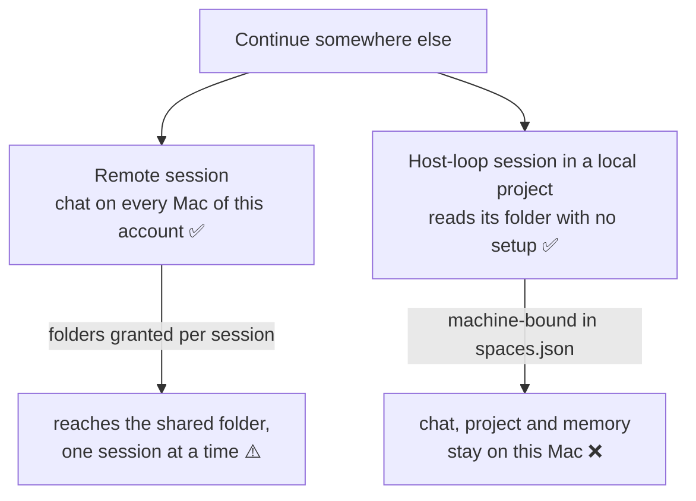
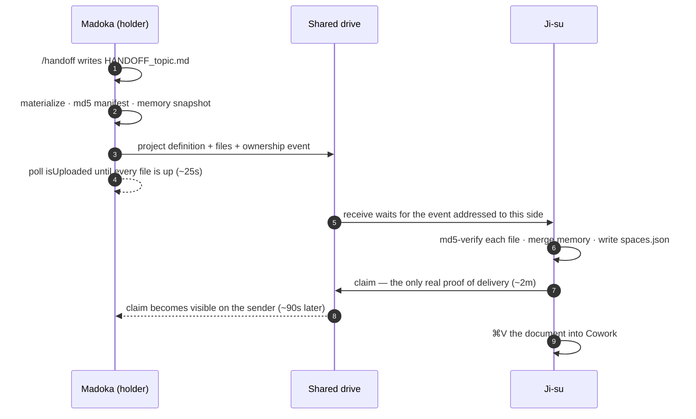

# Handoffs — moving a project between accounts and Macs

A **handoff** moves a Cowork project from one place you work to another — to the account in your other profile, or to your other Mac — with its files, its definition, what Claude learned on it, and a brief of where you were. Every side has a name: `Madoka`, `Madoka@work`, `Ji-su`.

- [When you need one](#when-you-need-one)
- [How a handoff works](#how-a-handoff-works)
- [Set up](#set-up) — [the shared drive](#1-the-shared-drive) · [the skill](#2-the-handoff-skill) · [each project](#3-each-project)
- [The daily loop](#the-daily-loop)
- [Between accounts on one Mac](#between-accounts-on-one-mac)
- [Memory](#memory)
- [Locking a Mac out](#locking-a-mac-out---hold)
- [Proving it arrived](#proving-it-arrived)
- [How long it takes](#how-long-it-takes)
- [The folder link](#the-folder-link)

---

## When you need one

What crosses on its own depends on the kind of Cowork session:



| Thing | Crosses by itself? |
|---|---|
| Files in a shared-drive folder | ✅ the drive syncs them, but they can arrive *dataless*: listed, with no content |
| Cloud projects, and **remote** sessions' chats | ✅ server-side, on every Mac signed into **that account** |
| Custom skills | ✅ by account |
| A **local** project (`Local` badge): its definition and folder link | ❌ written into one Mac's `spaces.json` |
| A local project's **host-loop** chats | ❌ never; the handoff document carries what matters |
| A project's memory | ❌ kept per Mac, per account |
| Anything at all, to a *different account* | ❌ accounts share nothing |

A handoff carries every ❌. It's measured, too: a remote session (Quicken Reconciliation) was visible on both Macs, while a host-loop one (an MS Korea strategy chat) never left its Mac ([finding 17](findings.md)).

---

## How a handoff works

Two steps per side. One happens in Cowork, because only the session knows what you were doing. The other happens in a terminal, because only a terminal can prove the transfer.



**Why the split.** A Cowork session is sandboxed to its project folder. It can't run `fileproviderctl`, see the shared `_handoff/` tree, or use any CLI, so it can never verify that a transfer completed. The terminal can never write the document, because the context lives in the session. Each side does only what the other can't, and each mechanism has exactly one implementation.

---

## Set up

### 1. The shared drive

```bash
./bin/tandem deploy       # puts the engine in the shared tree; on the second Mac the drive delivers it
./bin/tandem check        # ✓ shared tree present — if ✗, the drive hasn't synced yet: fix that first
```

Everything hinges on one folder **both Macs can see**. iCloud Drive is the default and needs no configuration:

```
~/Library/Mobile Documents/com~apple~CloudDocs/Claude/
    Projects/PROJECT/     the project's files: the folder the project reads
    _handoff/             engine, exported project definitions
```

Both Macs must use the **same** Apple ID. `tandem check` prints the account each one uses.

**Another drive.** Anything that's mounted and signed in on *both* Macs works. Check on each:

```bash
ls -d ~/Library/Mobile\ Documents/com~apple~CloudDocs ~/Library/CloudStorage/* 2>/dev/null
```

On the Macs this was built on, Dropbox was installed on both and looked like a fine choice. But it wasn't signed in on the laptop, so it would have failed silently at the worst moment. For Google Drive the path contains your email, so point each Mac at it:

```bash
./bin/tandem use-root "~/Library/CloudStorage/GoogleDrive-you@gmail.com/My Drive/Claude"
```

Use the same Google account on both Macs, and set Drive to **mirror** files rather than stream them (Settings › My Drive syncing options). Roots don't have to match between Macs; the folder link is per Mac.

### 2. The `/handoff` skill

Claude › **Settings › Skills › Add** → `skills/handoff/SKILL.md`. Skills sync by account, so add it once **per account** you'll hand work from, not once per Mac.

It writes `HANDOFF_<topic>.md` into the project folder and stops. The transfer belongs to the terminal. `skills/pickup/SKILL.md` is in the repo but deliberately not installed: `receive` already claims the project and puts the document on your clipboard.

### 3. Each project

Move the project's folder into the shared tree, once, on the Mac that has it:

```bash
ls ~/Documents/Claude/Projects/                     # the folder name is often NOT the project name
./bin/tandem rename "Finances" "Quicken Reconciliation"   # if they differ, align them first
./bin/tandem migrate "Quicken Reconciliation"
```

`migrate` copies into the shared tree and md5-verifies every file. Only then does it move the original aside, as `.PROJECT.pre-icloud-<time>`; it never deletes it. Then the first move to the other side, with no document yet:

```bash
./bin/tandem send "Quicken Reconciliation" --to Ji-su --no-doc   # on Madoka
./bin/tandem receive "Quicken Reconciliation"                    # on Ji-su, with Claude quit
```

`receive` writes the other Mac's project definition **and** its folder link, so there's no folder picker. Relaunch Claude and the project is there.

---

## The daily loop

| Where | Step | What it guarantees |
|---|---|---|
| Cowork, where you are | `/handoff` | `HANDOFF_<topic>.md` in the project folder: task, prerequisites, background, status, gotchas |
| Terminal, same Mac | `tandem send "P" --to Ji-su --note "…" --wait` | Materializes the folder and writes an md5 manifest. Exports the definition, snapshots memory, and records the ownership event. Then blocks until every file reports `isUploaded`, and with `--wait` until the other side claims it |
| Terminal, the other side | `tandem receive "P"` | Waits for the event addressed to *this* side and **md5-verifies every file**. Defines the project if new here, merges memory, claims it. Copies the document to the clipboard |
| Cowork, the other side | **⌘V** | the brief, in front of the session that has to act on it |

`send` won't ship a project without a `HANDOFF*.md` (`--no-doc` overrides), and warns if the newest one predates the last handoff. `receive` won't claim a project that wasn't handed to it. Once it's handed over, don't edit the project where you left it; `tandem status` shows who holds what.

---

## Between accounts on one Mac

Each profile is its own side, so this is the same loop:

```bash
./bin/tandem send "P" --to Madoka@work               # from the default account
./bin/tandem --profile work receive "P"              # as `work` — only `work`'s app needs closing
```

The files are already on this Mac, so the drive only has to round-trip the small ownership event. Run `/handoff` before the account hits its usage limit: at the limit, the session can't write the document. More in the [profiles guide](profiles.md#moving-work-to-another-account).

---

## Memory

Cowork keeps per-project memory, a folder of small notes plus a `MEMORY.md` index, separately on each Mac and for each account. `send` snapshots the sender's, md5-manifested and upload-verified with everything else. `receive` **merges** it in:

- memories the receiver lacks are added and indexed
- identical ones are skipped
- the receiver's own memories are kept as they were
- a **clash** (the same file, different content on each side) keeps the receiver's version and parks the sender's beside it as `name.from-<Mac>.md`, unindexed, for you to settle

Everything is backed up first, as `memory.bak-<time>`. Merging rather than replacing matters because both sides learn while they hold a project. After Adobe Stock Plan went to Ji-su and back, Madoka's 11 memories had the method and Ji-su's 1 had the newest status; replacing would have lost that line ([finding 12c](findings.md)).

```bash
./bin/tandem memory-install "P" --merge     # what receive runs
./bin/tandem memory-install "P" --force     # replace this side's memory with the snapshot instead
```

If Claude is open when you receive, memory waits; quit Claude and run the `--merge` line.

---

## Locking a Mac out (`--hold`)

The ownership log records who holds a project. It can't stop you editing the copy that stays behind. `--hold` can:

```bash
./bin/tandem send "P" --to Ji-su --note "…" --hold
```

| What it writes, on this Mac | Effect |
|---|---|
| A notice in the project's instructions | It lands in every session's system prompt here: *"CHECKED OUT TO Ji-su … refuse and say the project is checked out"* |
| The folder link, emptied | a session that ignores the notice still can't read a byte |

Both are reversed by `receive` when the project comes back, or by `tandem release "P"` by hand. Both edit `spaces.json`, so Claude must be quit. If it's open, `send` finishes the transfer and prints the `tandem hold` line to run afterwards. The notice never travels to the other side: its markers are stripped on export.

It doesn't cover anything outside Cowork, such as Finder, Excel or Quicken. Nothing in iCloud offers a lock, and locking the files would stop the drive writing the other Mac's changes back.

---

## Proving it arrived

```bash
./bin/tandem status       # who holds what, and the last note
./bin/tandem log "P"      # the project's ownership history
./bin/tandem check        # shared root, account, drive sync state, broken folder links
./bin/tandem conflicts    # iCloud conflict copies — must report nothing
```

The same digest on both Macs means the same bytes:

```bash
cd "$(./bin/tandem path 'P')" && find . -type f ! -name .DS_Store ! -path './.handoff/*' \
  -exec md5 -q {} \; -print | paste - - | sort | md5
```

---

## How long it takes

It is not synchronous. Measured between these two Macs over iCloud:

| Leg | Measured |
|---|---|
| `send` → every file `isUploaded` | **25 s** (5 files, 21.6 KB) · 12 s (28 uploads incl. a memory snapshot) · 56 s for 10 MB · ~110 s for 25 MB |
| `send` → receiver has verified and claimed | **2 min 12 s** · 2 min 46 s for 10 MB |
| that claim showing up back on the sender | ~90 s more |

Upload scales with size. Delivery to an idle Mac takes about 2–3 minutes almost whatever the size, because the delay is the drive noticing, not the bytes moving.

- **Uploaded isn't delivered.** `send` proves the bytes left this Mac; only the claim proves they landed. `--wait` waits for it.
- **A stalled receiver looks like a slow one.** If the receiving Mac's iCloud Drive has stopped pulling (seen after a reboot), nothing arrives however long you wait. `receive` and `check` say so; opening **Finder › iCloud Drive** restarts it ([finding 18](findings.md)).

---

## The folder link

A local project's folder link is one field: `folders[].path` in that Mac's `spaces.json`. There's no token, bookmark or consent record anywhere else. A project linked by Tandem is byte-for-byte the same as one linked in the app, and Cowork reads it without the folder picker ever opening.

- **Claude must be quit while it's written.** A running app rewrites `spaces.json` from memory and silently discards the change, so Tandem refuses to write it while the relevant profile's Claude is open.
- **Never link a symlink.** Cowork registers a symlinked folder as connected, then fails *every* read inside it with *"is not inside a folder connected to Cowork on this device."* Tandem always links the shared path itself, and `tandem check` flags any project that isn't.
- **Picking a folder by hand?** `tandem path "P"` prints the path and copies it to the clipboard. In the app use Add folder › **⌘⇧G** › paste. Finder hides `~/Library` and shows `Mobile Documents/com~apple~CloudDocs` as "iCloud Drive", so you can't browse there.
